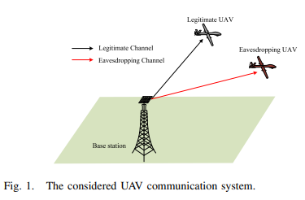
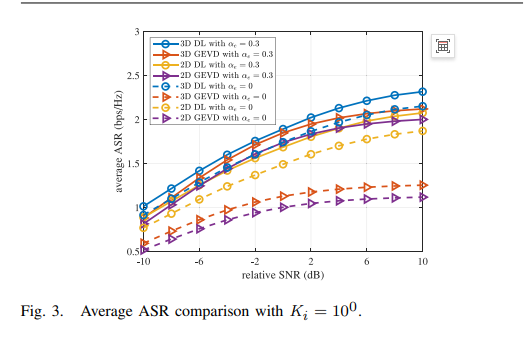
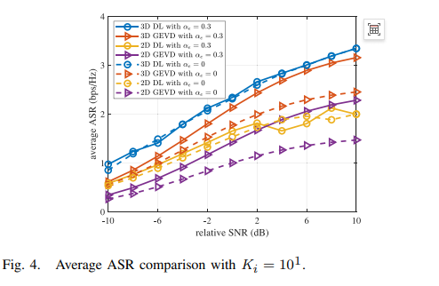
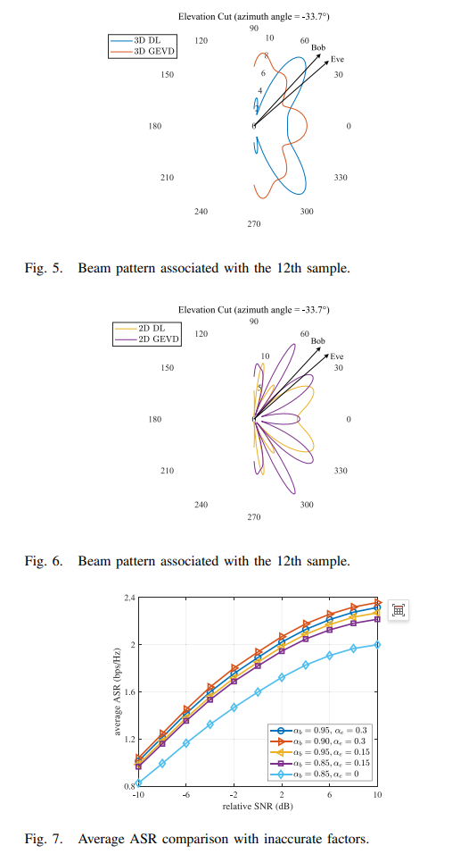

# [UAV+BF] Deep Learning-Driven UAV System for Robust Beamforming in 3D Communications with Safety Communication [with MATLAB+Python Code]

Beamforming is a promising technology for enhancing the security of wireless transmissions. However, optimal beamforming design based on partial channel state information (CSI) presents challenges. This paper proposes a three-dimensional robust beamforming method for unmanned aerial vehicle (UAV) communication systems from the perspective of physical layer security. Specifically, it aims to maximize the average secrecy rate of the considered system by designing a neural network to optimize the beamformers for confidential signals and artificial noise (AN). The use of partial CSI from both legitimate UAVs and eavesdropping UAVs is leveraged. Simulation experiments show that the proposed deep learning (DL)-based method can achieve superior secrecy rates and more flexible beam control capabilities compared to baseline methods.
Introduction: Unmanned Aerial Vehicles (UAVs) are seen as solutions for achieving ubiquitous connectivity, which is one of the key objectives of the fifth-generation (5G) and beyond 5G communication networks [1, 2]. However, the inherent line-of-sight (LoS) characteristics of air-to-ground (A2G) channels pose severe challenges to the secure transmission of UAV communication systems. Additionally, UAVs are typical resource-constrained airborne platforms, and balancing energy efficiency in the design of secure transmission measures for UAV communication systems requires consideration.
As a complement to traditional encryption methods, physical layer security techniques achieve secure transmission through signal processing, modeling, and coding, which can alleviate the need for energy efficiency in future communication networks [3]. Therefore, they have received extensive research in recent years [4, 5]. The application of physical layer security in UAV communication systems can achieve a compromise between secure transmission and energy efficiency, making it a hot research topic [6-10]. Due to the different angles provided by UAVs, beamforming, especially three-dimensional beamforming, is suitable for enhancing the secure transmission of UAV communication systems.
The optimal beamforming design under perfect channel state information (CSI) has been thoroughly studied, for example, in [11, 12]. In [11], a method based on Generalized Eigenvalue Decomposition (GEVD) was proposed to obtain the optimal beamforming vector. In [12], the covariance of confidential information was optimized, which is equivalent to beamforming. However, for completely passive eavesdroppers, it is difficult to obtain perfect CSI, even for legitimate receivers, due to delays and estimation errors, making the assumption of perfect CSI impractical. Therefore, it is necessary to study the optimization problem of beamforming vectors under partial or imperfect CSI, which remains an open issue. On the other hand, in previous studies, usually the transmission power and trajectory of unmanned aerial vehicles (UAVs) [8, 9] or the beamforming of UAV-mounted base stations [10] were optimized to enhance security performance, without considering the optimization of ground base station beamforming.
Inspired by recent research work showing the potential of neural networks in processing signal processing problems [13, 14], this paper proposes a three-dimensional robust beamforming method for secure communication in UAV systems. The main contributions are summarized as follows:
Unlike [10], this paper considers ground base station beamforming and achieves directional gain through a planar array.
By internally controlling the information beam in the vertical direction, it deeply explores the freedom brought by UAVs for system design.
A new neural network is designed to obtain a robust beamformer for partial CSI, which is not addressed in [6], and extends the application of deep learning to the field of secure UAV transmission.
Article illustration
Conclusion This paper proposes a three-dimensional robust beamforming method for drone communication systems based on deep learning. A neural network was meticulously designed and trained to address challenges posed by partial CSI. Simulation results indicate that the robust beamforming based on deep learning has superior safety performance compared to the baseline method, with three-dimensional beamforming outperforming two-dimensional beamforming. Furthermore, it demonstrates the potential of deep learning in the field of physical layer security. The research findings of this paper can be extended in two directions: 1) Robust beamforming for large-scale antenna arrays to form narrower beams for more precise pointing; 2) Joint design of beamforming and drone trajectory to ensure continuous safe transmission for mobile drones.

## Images

<!-- PAYMENT_BLOCK -->

## Get this dataset

- Payment link (Stripe): [Buy now](https://buy.stripe.com/3cs8yP7sY87d0vu9AB)
- Payment QR code: 

<!-- /PAYMENT_BLOCK -->
